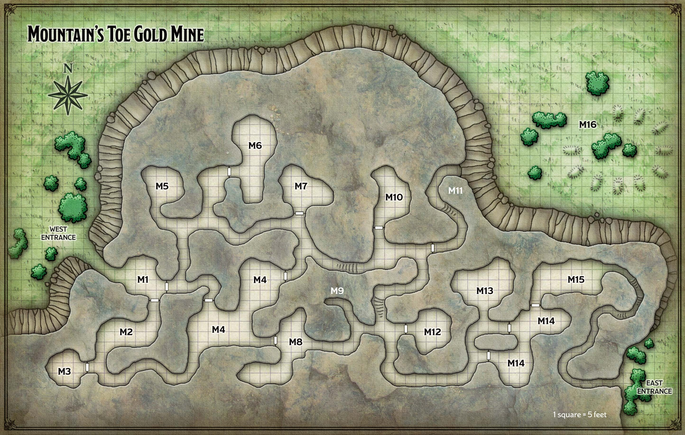
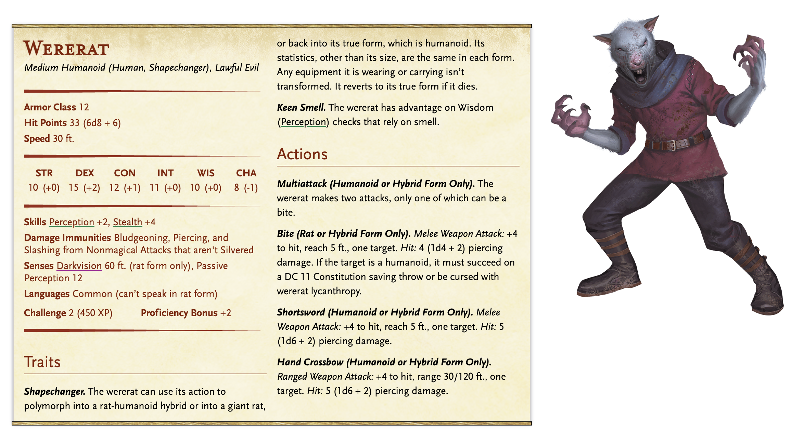
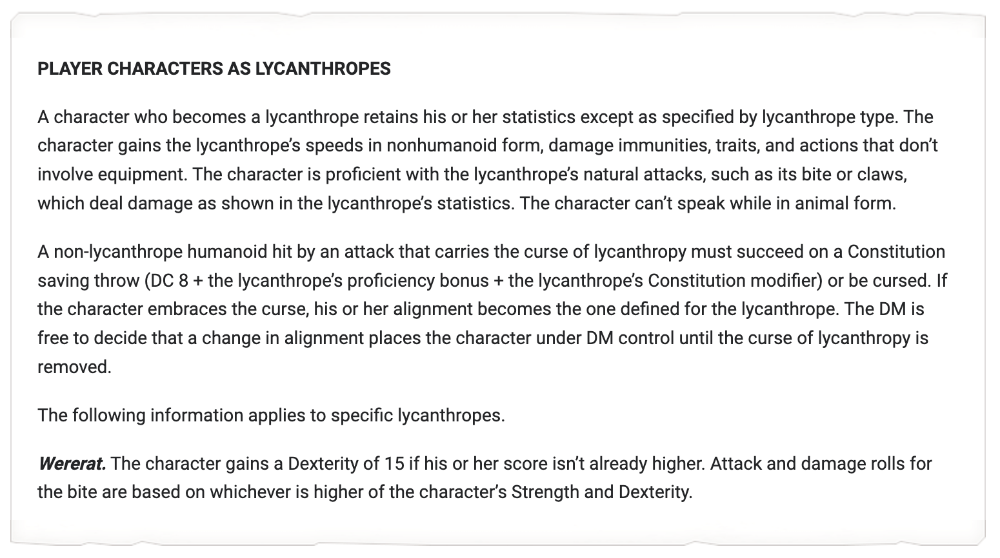
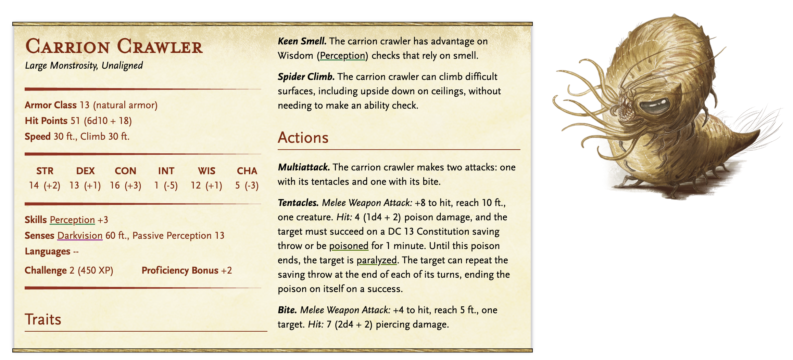
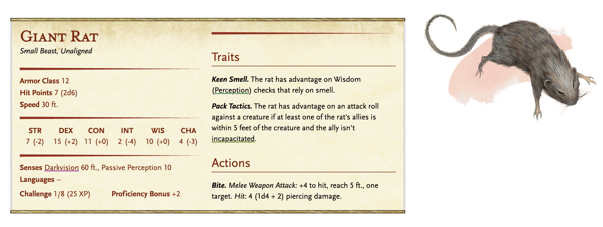

# Mountain's Toe Gold Mine REWRITE

**Quest Level: 2**

**THIS IS THE REWRITE VERSION**

## Travel

*The fastest way to reach the mine from Phandalin is to head northeast, skirting the foothills of the Sword Mountains. The mine is only 15 miles from Phandalin, so if the characters leave at dawn, they’ll be there before sunset.*

*But they will NEED to rest soon after arriving.*

### Coming from Butterskull Ranch

If they decide to go directly there from butterskull ranch, they will need to go to a meeting spot in between all three locations to wait for Don-Jon. He will arrive on horseback with [Sharlay Grift](../../npc_content/all_npcs.md#sharlay-grift-homebrew). *The players don't know this, but this is the last time they will see her alive.* **She will meet them at the fork in the road from the Triboar trail to the path headed south to the mine. As she's leaving, she throws a silver dagger to Eve. It is a +1 dagger made of silver. She says: you might need this.**

Sharlay will drop him off along with his "night goggles", a present. The quest is to escort him to the mine, but he will say he wants to make sure it is ready to start sending for workers. He has three ravens (Po, Gar and Ed) that circle overhead, ready to send to Neverwinter or Cormyr and post job notices for willing mine workers. 

As the goggles are a loan, Don-Jon will want to return them to the PME. 

Don-Jon will want to make sure:
* Each room is cleared
* There is an adequate space for a safe and for a secret office, though he will be fine telling the party
* The path to the secret entrance is made a secret

#### Plot stuff..

Of course, he doesn't know that the goggles are feeding information back to [Halia](../../npc_content/all_npcs.md#halia-thornton), and that she plans to overtake the mine once the threats are all cleaned out and she has a thourough mapping of the place.

The players will be able to detect magic on the goggles. They can also detect that Sharlay is hiding something. If they roll a nat 20 perception any time they are within 10 ft of Don-Jon, they will hear the scribing in the goggles. 

* If the goggles are returned without interference, the mine is 'couped' offscreen. 
* If the goggles are returned with PROPER interference, Halia will confront them
    * What's proper interference? The scribe bug could be futzed with by providing illusions of different scenes
    * I would take most creative plans
    * Halia's confrontation would involve trying to sabotage their reputation, and they will lose access to the Miner's exchange and anything else that they may help them with in the future.
* The the goggles are not returned at all, someone will try to take them from one of the party members in the night.
    * How many days do they get in grace? Maybe I roll a d4 after they get back to town and that's how many days they get to return them.

### On the way there, dead orcs

When the party gets within five miles of the mine, read the following boxed text aloud:

> A low ridge rises to your right, beyond which you see the Sword Mountains scrape the gray sky. But closer in, something is strewn across the rocky ground ninety feet ahead.

> “Well, ain’t that something,” says Don-Jon, pointing at what appear to be six dead orcs.

The orcs were killed by Cryovain the white dragon. They are clad in hide armor, and their greataxes and javelins litter the ground around them. Any character who examines the corpses and succeeds on a DC 12 Wisdom (Medicine) check can determine that extreme cold killed the orcs about three days ago. If the players can’t piece together what happened, Don-Jon says, “Looks like a white dragon saved us from some trouble.”

## Actual Quest

To complete the Mountain’s Toe Quest, the adventurers must escort Don-Jon Raskin safely to the mine. Once he sees that wererats have infested it, Raskin urges the characters to eradicate the “varmints.” If the characters refuse, Raskin is left to negotiate a truce with the wererats on his own — and is quickly turned into one.

### Surrounding Lore

The Mountain’s Toe Gold Mine, owned by a business consortium in Neverwinter, has been troubled by recent productivity problems. The owners have hired a no-nonsense overseer named Don-Jon Raskin to sort things out. But neither Raskin nor the owners know that the troubled mine has recently been taken over by a band of wererats calling itself the Whiskered Gang.

### Backstory

The Whiskered Gang has a nasty strategy. They will often bite their enemies - especially Orcs with their average wisdom - to intentionally turn them, and lord a possible solution over them. An enemy that has been bit by them has 3 + 1d4 + their CON or WIS modifier (whichever is higher) days until they have fully turned. 

Once this happens, they must make WIS checks everyday and perhaps after "traumatic events". They are assigned an insanity counter, set to 0. If they roll less than 10, they turn into their hybrid or rat form for some time, and the insantiy counter is increased. If they roll a 1, then they fail their wisdom check so hard that they full turn heart and soul, and become Chaotic Evil. 

The Gang bites opponents and tells them that they will give them the antidote after enough indentured work. In reality, the only thing that can cure them is a Remove Curse or Wish. They make the baby lycanthropes do henchman work until they give in to the curse all the way. At that point they are either killed or initiated into the Gang.

They used to occupy the Shrine of Sarvas, but when the Orcs showed up and took it from them, they got into a skirmish in which they bit three Orcs. Two of them showed up at the mine looking for a cure. They have been doing grunt work for the Gang ever since.

The Whiskered Gang mostly do crimes of opportinity. When Don-Jon Raskin arrives, speaking loudly about the mine he's just been hired to oversee. They plan to take him hostage and have him send out notices for workers, luring people into the mine to rob and turn. They think he's the owner when in fact he's the overseer.

He may ask the players to speak on his behalf when they negotiate if they have established a good relationship.

### Locations and Events

The characters arrive at the west entrance to the mine, which you can describe as follows:

> Hidden among bushes, a tunnel burrows into the foot of a soaring, snow-capped mountain. Above the mouth of the tunnel is a wooden plank with the words “Mountain’s Toe” carved into it in Common.

Don has never been to the mine and does not have a map, and can't help with navigation

MINE FEATURES

All tunnels and caverns in the mine are hewn from rock that has thin veins of gold ore running through it. Other common features are described below.

Ceilings. Ceilings throughout are 8 feet high and braced at regular intervals by wooden pilasters and beams.

Doors. All doors are made of wood with iron hinges and handles. The doors are fitted with locks, but none of them are locked. The keys needed to unlock and lock them are gone — stolen by a previous overseer who fled the mine.

Light. Oil lanterns hang from ceiling hooks in every room and tunnel.

#### M1 - Guard Post

**With a high enough passive perception (12), a player will notice shadowed figures rustling about. The walls have grooves large enough for giant rats (about the size of a terrier) to run. Where the walls connect to the ceiling is a groove about 3-4 feet high and 3-4 feet deep - large enough for a medium sized creature to run on all fours.**

By coming into the room without sneaking, they alert the gang to their presence. Don-Jon is oblivious: *Wow, quite spooky!*

The doors leading out of M1 are unlocked but the door leading into M4 from M1 is closed and unpickable, the adventures cannot continue on this path.

#### M2 - Wooden Posts

Wooden posts used for shoring up tunnels and caves lean against the walls here.

#### M3 - Crates and Casks

Stacked against the walls of this storage area are a dozen empty crates and a similar number of empty casks. **There are sketchy looking papers - a DC 10 investigation check will show that they are maps of the region - roughly drawn and overlain with symbols**

**A DC 15 investigation check will have a list of clerics in the area, but it will just say a name and a diety. A DC 7 Religion check will confirm that these are all good aligned deities.**

*Garaele - Tymora, Adabra - Chauntea, Pyula - Tyr, Renesslayer - Ilmater, Brant - Ilmater* 

#### M4 - Central Cavern

This is the ambush area!

When the players get into the room, the ambush is either that the players are randomly grabbed or directionally grabbed. If someone has a PP of 12 or higher, they notice the shifting in the room.

If randomly..

| Roll | Players Grabbed |
| ---- | --------------- |
| 1    |    Al, Arfer         |
| 2    |    Al, Dopio         |
| 3    |    Al, Eve           |
| 4    |    Al, Gasshole      |
| 5    |    Arfer, Dopio      |
| 6    |    Arfer, Eve        |
| 7    |    Arfer, Gasshole   |
| 8    |    Dopio, Eve        |
| 9    |    Dopio, Gasshole   |
| 10   |    Eve, Gasshole     |

Or if directionally, the two closest to the door to M8 are grabbed.

The bottom of the page describes the grabbing.

#### M5 - Storeroom

There is one wererat in the room and he ambushes the group and immediately goes hostile. The goal is for him to bite 1-2 players before going down.

A dozen crates of dry foodstuffs and nine casks of drinking water are stacked in the middle of this cave.

With a DC 10 investigation check, the players can find 2d6 rations.

**The pathway between M5 and M6 is blocked off!**

#### M6 - Wererat Den

**This used to be area M4**

Scattered about this cave are pickaxes, shovels, and other mining tools. The northeast section contains four giant rats. The southwest section contains wererats in human form: one male wererat for each party member (including Don-Jon Raskin but not sidekicks) plus a female wererat named Zeleen Varnaster — the leader of the Whiskered Gang. If Zeleen dies, another wererat takes over as leader as long as any of them survive.

The wererats invaded the mine after orcs pushed them out of their previous lair — an old shrine near Conyberry (see “Shrine of Savras”). 

They either negotiate or they fight. 

> For the first time, you get a good look at the creatures that have been scampering about the cave, and that took your friends. These are *wererats* - most in their hybrid form. Part humanoid, part rat. They have patchy fur and rotted teeth, fraying whiskers and clipped ears. A female wererat pushes through to the front of the group. She speaks in a raspy voice.

> "Which one of you is Don-Jon? It sounds like you think you own this mine. But do you? My name is Zeleen Varnaster. I would say.. that we own this mine." Some of the wererats around snicker, and one kicks a pile of rocks and chuckled. "Starver! Watch it!" She hisses. The others say, haha, get him Zeleen. She throws a chair at him. 

> Don-Jon seems anxious and wants to protect his job. He looks at the group, trying to communicate that these are bad guys. "We need you to lure in miners. But we don't need your friends around for you to do that. What if we picked them off, one by one?" And another one says - "We still have those two in a cell if we need extra, boss!"

They fight - it's four wererats and Zeleen against them and Don Jon. In the first move, Zeleen escapes using a disengage action and a dodge action. 

Treasure. Characters who search the cave find two sacks hidden under debris. One sack contains ten fist-sized chunks of gold ore worth 10 gp each. The other holds 82 sp, 450 cp, and a **true** pair of goggles of night.

#### M7 - Gold Storage

This cave contains two wheelbarrows and an empty bin. With a DC 10 investigation check, they will see crudely scratched into the wall: "HELP ME IM NOT MYSELF"

#### M8 - Equipment Storage

Picks, shovels, and wheelbarrows are stored here.

#### M9 - Dead End

Leaning against the back wall of this tunnel is a dead human miner with a pickaxe. Inspection of the corpse reveals that the miner was stabbed to death.

#### M10 - Overseer's Office

The wererats ransacked this cave, whose furnishings include a desk, a chair, an empty wooden chest, and a cot.

This is where Zeleen escapes to. If she does not die during this campaign, then Don-Jon will not feel safe here and they will not succeed their quest.

#### M11 - Carrion Crawler

A carrion crawler lairs in this tunnel, the north end of which is 20 feet up the mountain’s rocky slope. Characters can scale the slope with a successful DC 10 Strength (Athletics) check. The crawler can’t open the door at the south end of the tunnel, so it clings to the ceiling in the middle of the tunnel and attacks anyone who approaches from either direction.

#### M12 - Sleeping Quarters

This cave holds six wooden cots. With a DC 10 Investigation check, they can find two tattered cloaks, which could help them not be caught walking around the hallways.

#### **M13 - Holding Cell**

**This is where the kidnapped players are taken. If the player is martial, roll a d4 to determine how much of their weaponry is taken from them.**

**This cave is sealed off with a large boulder. It would take a DC 20 Strength check WITH help to move it. One player can attempt and the other can help, and if they fail then they fail. There is an amount of empty crates and rocks in the room that could be used as cover to hide.**

There is a large orc guarding the cell and will respond if talked to. The orc can be tricked or charmed into coming into the cell and helping them escape (either on purpose or not). The players can get the orc to move the boulder and come into the room with an easy check - DC 8 Deception, DC 10 Persuation, DC 12 Intimidation. The players can attempt a DC 10 Deception, a DC 15 Persuation, a DC 20 Intimidation or an illusory trick to get past the orc. Any sort of illusion trick would involve the orc failing a perception DC 10 perception check.

They will see outside the cell that there is an easy way to move the boulder into place, so its trivial to move the boulder back and block the orc inside.

#### M14 - Miners' Retreat

This cave has the second orc. He will immediately try to talk with the players, and tell them that he is being held hostage because of the imminent curse. He will become hostile when he realizes they tricked and trapped his friend.

He will tell the adventurers that they can get their stolen goods back in the other room, and that they should try to find their friends in one of the northern dead ends.

#### M15 - Evidence Room

**In here they will find their taken equipment and backpacks.**

#### M16 - Graveyard

This field contains a ring of earthen graves with pickaxes sticking out of the ground where headstones ought to be. Buried here are ten miners who died fighting the wererats for control of the mine.

Just beneath the dirt, with a successful investigation, can be spotted, the [Blade of the Patriarch](../../npc_content/magic_items.md#blade-of-the-pariah--blade-of-the-patriarch), a +1 Longsword (really the Blade of the Pariah). This is the first of the cursed items that can be found.

### Fights

#### Storeroom

1 wererat

#### The grabbing in the central cavern

The players are ambushed, and are all attacked with surprise. 

> I tell everyone to close their eyes for dramatic effect. I tap the three people on the head who have been hit with blindness and I tell them Im going to ask them to make a roll for it. The other two, I tell them if I tap them on the head they are going to make a strenghth check because they are being grappled.

> Blindness checks are DC 15 Constitution, and the grappling checks are DC 15 Strength. Both checks are with disadvantage. I have the two characters dragged away unable to speak move away from the table. The blind characters recover their sight to see its just them and Don-Jon.

> The grappled characters have been dragged to room M13

#### Guard Wererats (possible)

The two wererat guards don't want to fight, but will if necessary. If they are killed here, then there will be two less in the den fight.

#### Wererat Den

5 or 6 wererats and 4 or 5 giant rats

#### Rat Cave

This has 5 giant rats that attack on sight