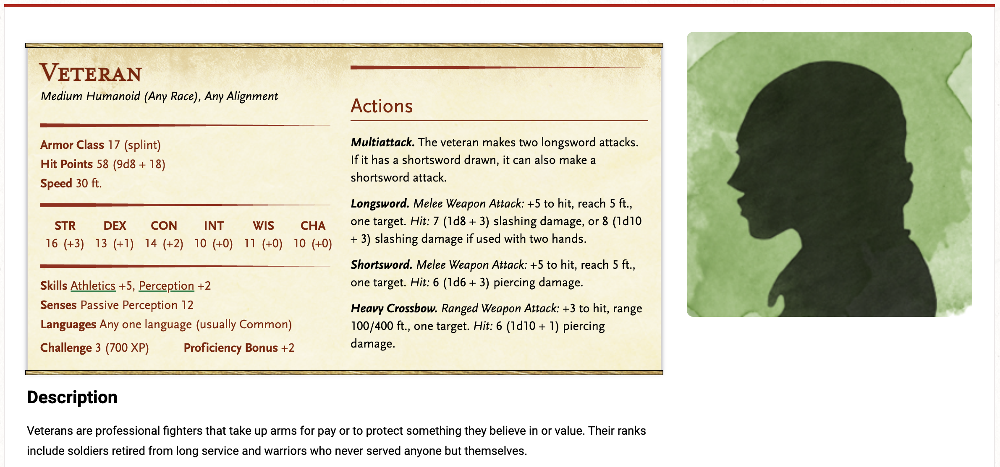
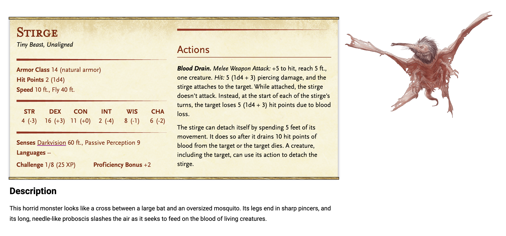

## Earning the Cure

For: [Gasshole](../players/gasshole.md), [Arfer](../players/arfer.md) and friends

Both Gasshole and Arfer have contracted lycanthropy.

They will have few options after leaving the dungeon to cure it. They must go to a cleric able to perform "remove curse", which might have a cost component, got to look that up. *This list is order from not effective to most effective choices*

- *Option 1: Neverwinter*: they can try to go to the big city, but **must lead them off this course**
    - Note: If Militsa has to leave the session early, she will insist on going to Neverwinter alone.

- *Option 2: Adabra*: she is on the rat's list as a good-aligned cleric in the region. However, if they visit her, they will find that she is not talented enough to perform the spell

> "Oh I wish I could help, I really appreciated how you helped me all those weeks ago... But I'm not talented enough as a cleric to be able to remove a curse like Lycanthropy. Have you met the Cleric of Tymora who visits Phandalin from time to time? If you're lucky, the lady of luck will be there for you, I'm sure."

- *Option 3: Marla*: if they do not go to the secret hideout, then they will not immediately be able to find Sister Garaele, so they can go through Marla who will give them the quest, but a worse version of it.

> ""

Later, when they see the Sister for the first time after talking to Marla:

> "I'm glad you found me, Marla told me all about your situation. I would appreciate if you could lend me your outside perspective on some issues while I prepare what I need to remove your curses."

- *Option 4: Sister Garaele*: if she is found in the secret hideout, then they get the quest directly from her. She will not be at the shrine when they first arrive back in town.

> ""

Make it clear that any investigation will take 4 hours of time, so only so many can be done in a day. If they split up they can cover more ground, but they wont be able to contact their teammates, and they may get into trouble. They should avoid a fight at all costs!

**WHAT COUNTS AS A SUCCESSFUL INVESTIGATION?**
They have to return an "item" to the sister. It won't always be the same item, but it should be clear when they happen upon it. Sometimes the sister will be lenient with the items (they can bring either item for Halia, and they will only be able to find the incorrect item for Thistle)

### Investigations

#### Marla
She is the test for them, and is presented as being low stakes, won't get mad or suspicious, and they are directed to investigate her and/or the Inn's kitchen.

##### Ability checks

##### Room description

> ***OBJECT*** A delicate silver feather, when its acquired, she says "oh that must be the clue that the Sister hid for you guys!

> ***WHERE*** Inside of the Inn legerbook, on the page which marks the day the adventurers started staying there. **There is no bookmark**, they have to search in the book for it.

> ***BIG LEARNING*** Marla is a Harper, and the Harpers are good aligned. Marla is a sweetheart who genuinely loves the adventures. They also learn what an investigation item might look like, and the two methods of finding one: stealth and conversation.

> ***BONUS*** The Inn is not doing well financially, and really only survives because of the strength of the community

What does the book say:
- the logbook details lots of information about them, but it has an endearing quality to it, not creepy or stalkery

- entries like « someday i’ll try the infernal drink they all can’t get enough of - if i work up the courage - but ever since seeing the state it left the little green one in, i’m not sure. i think i might end up green myself!!
- other cute stuff
- it will also say something like « surely they know about the harpers in phandalin by now? i know i haven’t been working too hard to keep it a secret from them, and that ridiculous sister in law of mine basically blurted it out all those weeks ago »
- if they really want, they can try to investigate the logbook itself, and they will see the numbers are not adding up. this is not nefarious though, this is just incompetence. it’s unclear how long the business can survive like this, but it’s not doing well. in a small town like this, they will stay afloat as long as the community supports them, people look the other way on their invoices sometimes, and there is a steady enough flow of visitors.
- they can get to this either by stealthing around or by talking to her 
- when they get it, the sister will come into the room at tell marla she is asking them to do these investigations, and marla will do a knowing laugh - oh what a mean task! i remember having to do that so so so many years ago
- they can ask her for help: look for harper sigils like harp symbols, delicate feathers, and even sometimes just the color silver. she is slightly disgusted by the lyncanthropy and recommends keeping it under wraps

#### Harbin

#### Ability Checks

#### Room description

> ***OBJECT*** A harper pin

> ***WHERE*** On the alchemy table

- Object: a harper pin
- where: on his alchemy table
- What do they find out: the dragon ate the old mayor, which is why he is the interim mayor. They can only find this out through dialogue. They must tell the mayor about the condition they found Sharlene in, iced to death, and he will tell you about how he found the previous mayor also iced to death. He covered up the death so as not to alarm the citizens, and hasn’t left his house since. It was not his idea to be interim mayor, notable people in town had decided he was the perfect combination of influential (banker) and inoffensive (coward) - and that when a real candidate came along, they felt confident he would step aside for them. He jokes that probably any of the five of them could petition to be mayor over him if they really wanted.
- After telling the story, he shows them the full alchemy table, where the pin is. He says that he has been working on his formula for ice resistance elixirs, if thats of interest to them - but he will have to sell them for cost (im not running a charity for Petes sake!)

#### Halia

The main room is as much meeting area as it storefront. There is a shop bar in the middle of the room, and a large table in the front left corner. Around the table stands Halia, in mourning black, and two robed, morose figures. There is a large doorway in the middle of the back wall that leads to the back rooms. The main room has various maps on the walls, maps on the tables, souvenirs of mining and logging in the area, mining equipment on the walls, on the bar, all around. 

Through the door is a small entryway room with two crate stacks, and a closed door to the left and a closed door to the right.

To the left is a storeroom with crate stacks. On the bottom wall are stacks with crates that are older, scratched up and dusty. On the top wall are stacks with crates that are not dusty, and have newspapers sitting squished between crates often. There is a window on the left which shines afternoon light in the room. [ If they search the room, it is a **15 AC Searching** to find the dagger. If they specifically search the crates along the top wall, it is a **11 AC Searching to find the dagger**]

To the right is a sort of meeting room, with three nice armchairs, a desk along the rightmost wall with some papers. On the bottom wall is a very large map of Faerun, with the Spine of the World mountain chain at the top of the map, the city of Baldur's Gate at the bottom of the map, and the High Forest on the eastern edge. Two familiar figures are sitting in the chairs: the dwarven excavators Dazlin and Norbus.

*She is in the Miner's Exchange, with two hooded figures who identify themselves as Sharlene's adoptive brother and long-term girlfriend. This is presented as suspicious, but the figures cannot be tricked or persuaded into revealing anything additional about their identity.*

> ***OBJECT*** There are two, and either will suceed the investigation. The one actually planted by the Harpers is a bloodstone with a harper symbol engraved and inlaid with silver on the backside (they will have to turn it over to see this). The other object opens a new mystery - a silvered dagger identical to the one Sharlene gave Eve, but with a hollow in the hilt, which could fit a message. Does Eve's dagger hold a message in the hilt?

Now that they know what to look for, its only a 12 DC Investigation check to find the hollow pocket in the hilt. Inside the hollow is a message that says, in hurried script: "THERE IS MORE GOING ON THAN WE KNOW"

> ***WHERE*** The PME has two backrooms. In the left one there are tons of boxes and the dagger is hidden in between the stacks. In the right one there is a desk with papers and three medium-comfortable chairs. The bloodstone is on the back right corner of the desk, "face down". However, also in this room are the shield dwarves [Dazlin Grayshard](../../npc_content/all_npcs.md#dazlyn-grayshard) and [Norbus Ironrune](../../npc_content/all_npcs.md#norbus-ironrune) fron the excavation.

##### Fight with the dwarves

Norbus is nearly catatonic with fear, trembling in his chair, muttering under his breath. Dazlin, on the other hand, is blinded by rage. He is seething when the adventurers enter the room. He casts arcane lock on the door once they are all inside the dark room, and attacks. In between attacks he yells things like - it's your fault! You tricked us! Evil adventurers, I know it, I smell evil on you!

> ***BIG LEARNING*** They should walk away suspicious and afraid of Halia, and feeling like Sharlene's friends are not really who they say they are. It should be odd that they were able to get to town so fast, considering they are coming from Neverwinter.

*FIGHT IN THE BACKROOM*

+Poison resistance, Darkvision 60ft, weapon is used with both hands, so 1d10 + 3 slashing

+Reckless attack from his emotional disturbance, so every attack is with advantage, and every attack against him is with advantage as well

#### Linene
She is in her store, they are directed to look into her store to find and investigate her. *[She is from the high forest, further east that Yartar, and ships through Yartar]*

##### Ability checks
The boxes with the smeared paint cannot be read by any check, but a **15 DC Insight or Perception** will show that all the crates in the room have some of the red paint - maybe there are some crates around that aren't as smeared?
If they know what the boxes say ("YTAR"), she will tell them that Thistle miswrote what she had asked him to write. After hearing this, a **10 DC Charisma or Persuasion** or a **18 DC Intimidation** will be needed for Linene to tell them about her home in Yartar.

> "I try to send money and goods whenever I can, and I often import shipments from Yartar, too. Do you know the regions east of here? Are you all from the Sword Coast? Here, grab the tallest map from that box and I will show you!"

##### Room description
The main store room is quite wide horizontally, and the 35-foot long shop bar accentuates this. Behind the bar is the main stock of weapons and armor that are for sale. On the left side of the room, by the window, is a training dummy and a stack of boxes with sightly smeared red paint next to the front door. On the right side of the room is a medium-sized, crude urn and a crate with several large rolled up paintings near the window. To the right of the bar, in the back right corner of the room, is a small door leading to the back stock room. Linene is standing behind the bar, ready to greet the adventurers.

The stock room is full floor to ceiling with crates - full and empty, weapon racks with rusted weapons, stacks of papers, etc. Every crate has smeared red paint, and on one, very visibly, is printed the letters Y T A R.

> ***OBJECT*** Small delicate silver sculpture, in the shape of an olive branch. "Oh, I had an olive tree right outside my house back home. They are very common in my town".

> ***WHERE*** Inside a rolled up map inside the vase, the map is of the region around Yartar. If they get Linene talking about it, she may want to show the adventurers a map of where she came from.

> ***BIG LEARNING*** All referrences to Y'Tar are to throw them off - she genuinely knows nothing about that plot, and is conspiracy free. *This investigation should clear her*

> ***BONUS*** Maybe this makes them want to look into Thistle next?

Some notes I wrote:

- her investigation will show that she is truly uninvolved in the schemes they have laid out
- they will need an investigation check, but mostly they will need to talk with her
- they should investigate the YTAR boxes, and hopefully she will complain about how that idiot thistle can’t write - she told him clearly to mark YARTAR on the boxes, where she’s from and where she ships goods to
- the letters YTAR don’t mean anything to her 
- maybe because this is through dialogue, she says, you guys were here recently - did any of you leave this ? i found it inside my map of the eastern regions, of yartar. it’s some kind of small delicate silver sculpture, in the shape of an olive branch

#### Frederico - Big Wet Fred

BWF has a big house with a side room and a large set of double doors which lead outside, where he has a small stable for grazing field for the horses and mules he tends. The adventurers will find him in the back of his house (a sign says he is hanging out in the back, and the front door is locked), standing in the big doorway looking at his livestock. There is a trapdoor in the corner of his living room (which the players have noticed before), leading to his basement.

His basement is a small entry room and a boarded up side room. There is nothing of interest in the entry room, just some crates. They must break open the boards to access the rest of the basement.

The intention is for them to investigate purely by stealth, but if they want they can engage him in conversation. He will say at some point he heard his has rats scurrying around in his basement, "even past the boarded up part". 

##### Ability checks

The front door is a **25 DC Sleight of Hand**, the trapdoor is a **15 AC Sleight of Hand**. They can also search nearby the trapdoor and with a **10 AC Survival** or **12 AC Insight** they will see that a loose board on the floor boardering the door is rotted, and they could reach the latch on the other side via that, without having to make a check. 

A **15 AC Survival** check outside will show boar tracks. A **15 AC Charisma** on BWF will allow them to find out that Sharlene was riding one of BWF's horses when she saw the adventurers, and when she died. 

> ***OBJECT*** A delicate silver feather pen, much too tiny for Fred's huge sweaty hands,

> ***WHERE*** On a desk, on top of a stack of hastily written letters.

If they search hard, they will see that one of the letters is written to someone named 'Yargath'. The letter says that he has a contact which manufactures chain mail fit for stocky, tusked beasts. In exchange he asks for money, favors and protection. It is possible the letters get damaged in the fight (if the players piss me off). 

There is a "to do note" on top of the letter with the words, How do I get this to them? The date on the note indicates that it was written several weeks ago. 

> ***BIG LEARNING*** They may catch on that Big Wet Fred is acting somewhat in league with the Boar cult, even if just by coersion. Ultimately, whatever their takeaway, its probably fine. He's not that important. They learn the name of a person who is on the boar side.

> ***BONUS*** If Eve is still with them, she notes that there is a horse there she can steal. If Eve has already left, BWF tells them that a young woman stole his hours that very afternoon - she seemed familiar but he wasn't sure.

##### Fight 

*FIGHT IN HIS BASEMENT*

There are 6 stirges in the basement, 2 groups of three. Each group will have the same initiative, for simplicity's sake.

#### Other stuff

If they walk near the foresty area of town, they will see Thistle